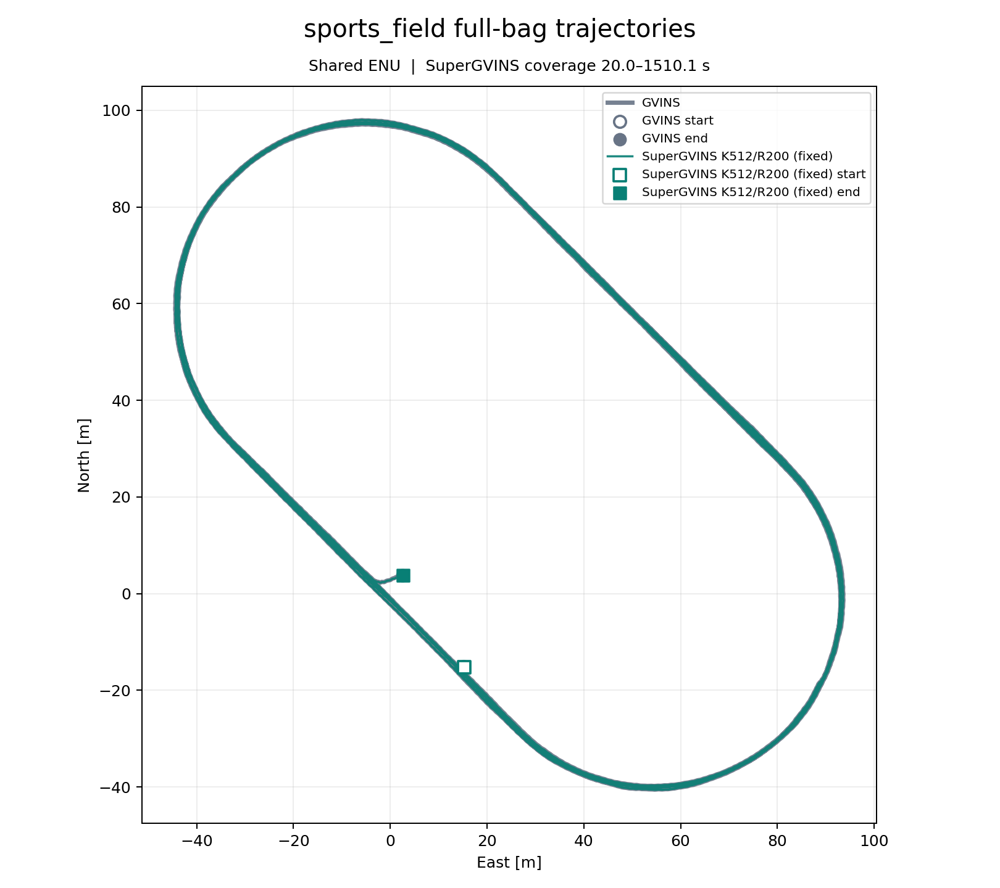

<h1 align="center">SuperGVINS</h1>
<p align="center">SuperPoint 与 LightGlue 前端驱动的紧耦合 GNSS–视觉–惯性估计</p>
<p align="center">
  
  
  
  <a href="LICENSE"></a>
</p>

## 项目概览

SuperGVINS 在 [GVINS](https://github.com/HKUST-Aerial-Robotics/GVINS) 的滑窗后端上接入学习式单目前端。后端联合优化视觉重投影、IMU 预积分以及 GNSS 原始伪距和多普勒观测。关闭 GNSS 后可运行视觉惯性里程计。

| 模块 | GVINS | SuperGVINS |
| --- | --- | --- |
| 特征提取 | Shi–Tomasi 角点 | SuperPoint 每图推理一次，最多保留 512 个候选 |
| 帧间跟踪 | KLT 光流 | LightGlue 匹配相邻图像的候选，RANSAC 后优先延续长轨迹，最多输出 200 对 |
| 推理 | OpenCV | ONNX Runtime，支持 CPU 和 CUDA |
| 后端 | 视觉、IMU、GNSS 紧耦合 | 沿用 GVINS 滑窗后端和隔帧优化，支持逐帧审计与残差诊断 |

仓库包含前端包 [supergvins_feature_tracker](feature_tracker/)、后端包 [supergvins](estimator/)、[传感器配置](config/visensor_f9p/)及[回放和评估工具](tools/)。

## 演示



示例使用 `sports_field.bag` 完整回放，核对了 30,205 张输入图像。图中展示 GNSS 对齐后可地理定位的轨迹。每套系统使用各自的 anchor 和 yaw 将位姿转到 ECEF，再投影到同一个 ENU 坐标系。

## 数据集与模型

从 [GVINS-Dataset](https://github.com/HKUST-Aerial-Robotics/GVINS-Dataset) 获取 `sports_field.bag`，放到 `~/catkin_ws/data/gvins/`，或通过回放工具的 `--bag` 指定路径。配套配置订阅 `/cam1/image_raw`、`/imu0` 以及原始 GNSS 和时间同步话题。

模型文件由使用者按各自上游条款取得。[SuperVINS 的 ONNX 模型目录](https://github.com/luohongk/SuperVINS/tree/e9689cf72cebbc7901b110ff201daedf27b0c3ff/supervins_estimator/weights_dpl) 中的以下两个文件与本项目验证使用的模型一致。将它们放到本仓库的 `weights/`。

| 文件 | 用途 |
| --- | --- |
| `weights/superpoint.onnx` | 输出关键点、分数和 256 维描述子 |
| `weights/superpoint_lightglue_fused_cpu.onnx` | 输出两帧间的匹配索引和分数。文件名保留上游命名，该模型已通过 CPU 和 CUDA 回放 |

## 编译

本项目在 Ubuntu 20.04、ROS Noetic、C++14、OpenCV 4、Eigen 3、Ceres 2.1 和 ONNX Runtime 1.23.2 下验证。CUDA 推理需要相应的 ONNX Runtime GPU 包及与之匹配的 CUDA 和 cuDNN。离线轨迹绘图使用 Python 3、NumPy 和 Matplotlib。

将 SuperGVINS、GVINS 和 `gnss_comm` 放在同一个 catkin 工作区。SuperGVINS 依赖 GVINS 提供的相机模型和 `gvins/LocalSensorExternalTrigger` 消息。

```bash
source /opt/ros/noetic/setup.bash
mkdir -p ~/catkin_ws/src
cd ~/catkin_ws/src
git clone https://github.com/brucema49/SuperGVINS.git
git clone https://github.com/HKUST-Aerial-Robotics/GVINS.git
git clone https://github.com/HKUST-Aerial-Robotics/gnss_comm.git
cd ~/catkin_ws
catkin_make -DONNXRUNTIME_ROOTDIR=/path/to/onnxruntime
source devel/setup.bash
```

`ONNXRUNTIME_ROOTDIR` 指向含 `libonnxruntime.so` 的目录或含 `lib/` 子目录的发行包根目录。CUDA 回放时，把对应的运行库配置到动态链接器搜索路径。回放工具也支持重复指定 `--cuda-lib-path`。

## 运行与评估

从已加载 ROS 和工作区环境的 catkin 工作区运行。回放工具会启动独立的 ROS master，为每次运行保存配置快照和输出。

```bash
# CPU 短测，验证前后端和时间戳覆盖
python3 src/SuperGVINS/tools/run_sports_field.py \
  --mode full --device cpu --gnss on --duration 2 --rate 0.1

# CUDA 全包回放
python3 src/SuperGVINS/tools/run_sports_field.py \
  --mode full --device cuda --gnss on --full-bag --rate 1

# 原 GVINS 基线
python3 src/SuperGVINS/tools/run_sports_field.py \
  --stack gvins --mode full --device cpu --gnss on --full-bag --rate 1
```

`--mode frontend` 仅运行前端。`--gnss off` 运行纯视觉惯性估计。通过 `--config` 选用自定义 YAML。手动使用 [ROS launch](estimator/launch/visensor_f9p.launch) 时，先把配置中的输出路径改为本机路径并创建目录。

| 文件 | 内容 |
| --- | --- |
| `frontend_frames.csv` | 图像时间戳、候选和发布对数、提取与匹配耗时 |
| `backend.csv` | 后端接收和隔帧处理记录 |
| `vins_result_no_loop.csv` | 估计器在本地 world 系下的位姿和速度 |
| `gnss_result.csv` | 图像时间戳、ECEF 位置、航向、钟差和 ECEF anchor |
| `summary.json` | 回放覆盖、节点退出状态和输出统计 |

比较两次 GNSS 联合回放时，传入两路的 `vins_result_no_loop.csv`，工具会使用各自同目录下的 `gnss_result.csv` 将轨迹转换到同一个 ENU，并导出轨迹图、坐标 CSV 和同时间戳差值统计。

```bash
python3 src/SuperGVINS/tools/compare_trajectories.py \
  --supergvins /path/to/supergvins-run/vins_result_no_loop.csv \
  --gvins /path/to/gvins-run/vins_result_no_loop.csv \
  --out-dir output/supergvins/comparison
```

## 致谢与许可证

后端基于 [GVINS](https://github.com/HKUST-Aerial-Robotics/GVINS)。前端参考了 [SuperVINS](https://github.com/luohongk/SuperVINS) 的学习特征方案，感谢 [SuperPoint](https://github.com/magicleap/SuperPointPretrainedNetwork) 和 [LightGlue](https://github.com/cvg/LightGlue) 作者发布模型和代码。

项目源码采用 [GNU GPL v3](LICENSE)。仓库内的 [ONNX Runtime 头文件](feature_tracker/src/ort_include/) 遵循其 [MIT 许可证](feature_tracker/src/ort_include/LICENSE)。模型使用遵循各自的上游条款。
